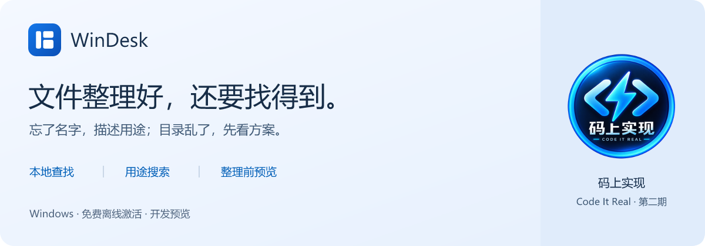

# WinDesk

免费的 Windows 本地文件查找与整理工具。**忘了文件名，描述用途找；目录乱了，先看建议与预览；整理后，仍能按旧名找回。** 首次免费激活，无试用、订阅、广告、商城或在线账号。

## 下载体验版

**0.19.1 Windows 开发预览发布草稿，`published=false`。本文尚未公开，不代表新版已可下载。公开可用状态以[项目 Releases](https://github.com/ebrx/windesk-releases/releases)中的对应版本条目为准，既有公开版本及其记录保留。**

[**查看公开 Release 与校验附件**](https://github.com/ebrx/windesk-releases/releases)

| 项目 | 0.19.1 准备状态 |
| --- | --- |
| 已验构建 | R29 Windows 开发预览；精确 App/core 身份见[验证范围](TESTED.md) |
| 体验 ZIP 文件名、字节数与 SHA-256 | `__PENDING__` |
| 云端附件与匿名下载后校验 | `__PENDING__` |
| 适用范围 | Windows 11 x64；只列指定本机已验范围，不作低配或全部设备承诺 |
| 首次激活 | 免费、机器绑定、不设到期、离线验签；[领取步骤](ACTIVATION.md) |
| CI | 最终运行记录 `__PENDING__`；不宣称全 CI 通过 |

完整解压后运行 `WinDesk.exe`，不要只复制主程序。GitHub 的 **Source code** 是本说明仓库归档，不是软件安装包；主程序源码保持私有。

[首页](README.md) · [快速开始](GETTING-STARTED.md) · [免费激活](ACTIVATION.md) · [AI 与性能](AI.md) · [已知限制](KNOWN-LIMITATIONS.md) · [验证范围](TESTED.md)

## 演示与联系作者

作者：**码上实现 / Code It Real**。沿用原公开横幅；它是产品介绍，不是新版界面或 AI 效果证明。已有旧版录屏不作为 0.19.1 完整演示，新版完整实屏演示尚未验收。

- **免费领码与联系：** [ebrx@vip.qq.com](mailto:ebrx@vip.qq.com)，或 [B站作者主页](https://space.bilibili.com/481835793)私信。UID：481835793。
- **问题反馈：** [GitHub Issues](https://github.com/ebrx/windesk-releases/issues)或邮件。附版本、步骤、错误文字与脱敏截图，不必发送私人文件或索引。
- **软件许愿：** 告诉我实际要完成什么、哪一步不顺手，也欢迎指出可砍掉的功能。反馈不等于承诺全部实现。

这里是**码上实现，你的免费软件许愿池。你提需求，我来实现。**

## 从这里开始

**ZIP 完整解压，首次免费激活，先用副本。** 基础用途搜索带本地检索组件，无需另装 Python、Ollama 或 API 密钥。可选 AI 分类和命名另需自选本机生成模型或兼容 API。

1. 取得对应版本完整 ZIP，核对外置校验记录，退出旧版托盘进程后解压运行。
2. 按软件显示的机器码向作者免费领码，收到激活码后粘贴；不需要付费、在线账号或密码。
3. 添加一组副本，描述用途搜索，查看依据；运行 AI 建议后看前后双树或原名/新名对照，再确认少量操作并验证有条件撤销。

名称先可查，正文和用途索引在后台补齐；长文仅处理有界文本，不进行 OCR。未提取内容不代表不存在。详细步骤见[快速开始](GETTING-STARTED.md)。

## 不只按后缀，重点解决三件事

| 遇到的问题 | 怎么用 | 先核对什么 |
| --- | --- | --- |
| 只记得要做什么，不记得文件名 | 描述用途找候选 | 看依据，区分说明、申请、模板、实际记录 |
| 资料散落、目录深浅不一 | 递归索引后在前后双树预览分类 | 类别与完整目标，工程/软件及人工保护边界 |
| 编号名或误导名难辨 | 单独预览 AI 内容命名 | 是否确需修改，稿态、申请性质及身份是否保留 |

分类建议只在所选根下一级用途类别，不是任意多层自主重构。分类与命名分别预览、分别确认。模型生成用途标题；程序保留可核对身份、扩展名与有直接依据的稿态后继续校验，但仍可能漏改或误判。

确认后的操作记录保留原名与位置，可查当前去向；满足文件身份、日志及目标条件时可整批撤销。外部改动或占位不强行覆盖，中断可能部分完成，日志不替代备份。

## 本地优先，也可自选 API

本机 Ollama 和生成模型须自行安装、下载，启用前评估当前配置。自动模式核实 GPU 分配、内存、显存和完整任务速度，不合适时不建议开启；CPU 模式也需单独评估。

兼容 API 自备服务、模型和密钥，每次发送资料前须明确授权，默认取消；本机代理也可能联网。当前协议/界面只用自有模拟服务核对，不是云模型效果认证。[AI 与性能](AI.md) · [隐私说明](PRIVACY.md)。

## 免费激活码说明

软件免费、首次直接激活，没有试用倒计时、收费或订阅。领码用于联系用户与收集反馈；激活码机器绑定、不设到期、客户端离线验签。换机或重装导致不可用时联系作者免费补领；不要公开机器码与激活码。[完整步骤](ACTIVATION.md)。

## 验证范围与限制

R29 本机原生 24/24（80.73 秒）、离线检查 22 项通过。R29 实际 App 的模型设置/自有模拟 API 流程 14 项、激活/受控归档流程 24 项检查通过。API 流程没有真实云请求或真实模型推理；归档界面证据原始范围为一份受控文件，含旧名查回、撤销与重启历史，不扩大成大量文件或任意目录通过。 PrintWindow/WM_PRINT 包含离屏渲染，不能认证真实屏幕 compositor、玻璃材质、全部 DPI/多屏及闪烁；密码编辑控件的严格托管 UIA 语义、跨进程实际字体外观仍有限制，人工讲述人检查未完成。原生密码样式、受保护 MSAA 状态等已有局部证据，不等于所有 UIA 要求已过。 远端 CI 的旧测试控件定位仍在修复，最终 Debug/Release 状态须另行核对；本稿不宣称全 CI 通过。

R28 真实模型的五组已见回归（对抗、V2、V3、V4b、V5）分类各 10/10；前四组有用改名各 7/7，V5 为 6/7，一项预算类误导名被误判为无需修改，仍漏改。各组清楚原名 3/3、两个不足/越权对照 2/2 保留。 R29 只收紧稿态合成 helper 的子句取词范围；40 次已封存 A/B 请求的精确请求离线回放、156 条最终结果与 R28 真实预测一致。该回放不是 R29 对全部已见材料再次真实生成。

R29 首次 V6 内部冻结留出在预测封存后经独立代理逐例评审：分类 10/10、有用改名 7/7、清楚名 3/3、控制 2/2，硬角色/状态反转及身份事实错漏均为 0，原冻结门槛通过。它不是外部第三方认证、人类最终验收或市场准确率。

## 本轮已验与仍待验

160 条冻结查询复用既有缓存，排名与原基线一致：42 条有目标私有查询均 Top1，另 2 条未判定不计成功；合成正例 Top1 107/108、Top5 108/108，保留一项 rank 2；8 条无答案查询均无候选，禁止候选为 0。CPU 查询 P50 19.16 ms、P95 27.68 ms，初始化另计 738–830 ms。没有重新提取、全量编码文档或重建索引，不代表新建索引质量、低配性能或真实界面响应时间。

本机 RTX 5080 16GB、qwen3.5:9b 配置评估完整 A+B：cold 13.479 秒、warm 6.402 秒，仅代表当前设备/服务组合。首次 V2/V3/V4b/V5 未通过记录保留，不以修复后的复测覆盖原结果。V4b 首次为分类 9/10、有用改名 4/7、身份事实丢失 2 项；该组便携软件 stub 的自动边界预检不足及预测前增加手动整体保护的事实同样保留，不能写作本组自动软件识别通过。

纯净低配、完整实屏、多 DPI/多屏、长期压力、真实云效果和人类最终体验仍未完成验证。包校验和匿名下载后结果须待实际取得再填写。[已知限制](KNOWN-LIMITATIONS.md) · [验证范围](TESTED.md)。
